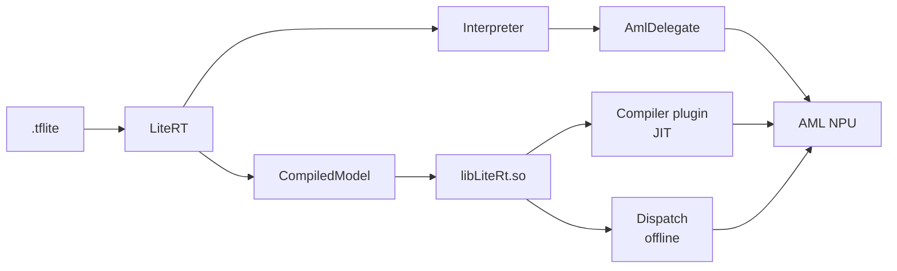

# LiteRT

[LiteRT](https://developers.google.com/edge/litert/overview) is Google's on-device inference engine for deploying ML and GenAI models on edge platforms, with tools to convert, optimize, and run them. Inference stays on the device (Android, iOS, Web, IoT, and desktop). Models use the `.tflite` format.

LiteRT 2.x adds the `CompiledModel` API, the runtime interface for hardware acceleration. The `Interpreter` API (formerly TensorFlow Lite) stays available for compatibility and reaches accelerators through delegates. This tree connects both interfaces to the AML NPU.

## Structure

- `example/` — runnable samples and prebuilt APKs.
- `example/APP_Demo/` — Android camera YOLOX apps, one per runtime interface.
- `example/APP_Demo/APP_CompiledModel_Demo/` — YOLOX through LiteRT `CompiledModel`.
- `example/APP_Demo/APP_Interpreter_Demo/` — YOLOX through TFLite `Interpreter` and `AmlDelegate`.
- `example/APK/Release/` — current demo APKs, ADLA **v2.0.2.228.231.0** (2026.11.13).
- `example/APK/Histroy_Version/adla_2.0.2.7.6_1020/` — 2026.10.20 APKs, ADLA **v2.0.2.7.6.0**.
- `example/LiteRT_native_case/` — minimal C++ `CompiledModel` JIT sample.
- `libs/` — prebuilt libraries for the two AML paths.
- `libs/CompiledModel_libs/` — `libLiteRt.so` plus the AML dispatch and compiler plugin, grouped by target.
- `libs/Interpreter_libs/` — Android `LiteRT_AML.aar` and `libAML_Delegate.so`.

## example

### APP_CompiledModel_Demo

Real-time object detection. The camera preview is letterboxed, then run through a YOLOX model (`yolox_s_w8a16_f16_dispatch.tflite`) with LiteRT `CompiledModel`. Detection boxes are drawn back onto the preview. Frames are dropped while inference is busy.

Dependencies:

- **API**: Maven `com.google.ai.edge.litert:litert:2.1.0`
- **Native**: `libLiteRt.so` from `libs/CompiledModel_libs/arm64`, placed in `app/src/main/jniLibs/arm64-v8a/`
- **AML NPU**: `libLiteRtDispatch_Aml.so` and `libLiteRtCompilerPlugin_Aml.so` from the same directory. NPU is used when `USE_NPU=true`

Open `example/APP_Demo/APP_CompiledModel_Demo` in Android Studio and run it on an `arm64-v8a` device. See that directory's README for packaging details. The current prebuilt APK is `example/APK/Release/Yolox_compiledmodel_261118.apk` (ADLA **v2.0.2.228.231.0**). The 2026.10.20 build is `example/APK/Histroy_Version/adla_2.0.2.7.6_1020/Yolox_compiledmodel_261102.apk` (ADLA **v2.0.2.7.6.0**).

### APP_Interpreter_Demo

Same camera YOLOX flow, using TFLite `Interpreter` and `AmlDelegate`. The model is `app/src/main/assets/yolox_s_w8a16_f16.tflite`. No `cache_path` is set, so the delegate compiles online (JIT) into the app cache and reuses the `.adla` file on later launches.

Dependencies:

- **Interpreter API**: Maven `org.tensorflow:tensorflow-lite:2.16.1`
- **AML delegate**: `libs/Interpreter_libs/Android/arm64/LiteRT_AML.aar`, copied to `app/libs/LiteRT_AML.aar`
- **Board runtime**: `libnnsdk.so`, `libadla.so`, and `libteec.so` in `app/src/main/jniLibs/arm64-v8a/`, loaded by `dlopen`

`libAML_Delegate.so` next to the AAR is the C++ external delegate. This Java demo does not load it.

Open `example/APP_Demo/APP_Interpreter_Demo` in Android Studio and run it on an `arm64-v8a` device. The first launch stays on “Loading model (AML JIT)…” until compilation finishes. The current prebuilt APK is `example/APK/Release/YOLOX_Interprerter_261118.apk` (ADLA **v2.0.2.228.231.0**). The 2026.10.20 build is `example/APK/Histroy_Version/adla_2.0.2.7.6_1020/YOLOX_Interprerter_261102.apk` (ADLA **v2.0.2.7.6.0**).

### LiteRT_native_case

Minimal C++ sample that JIT-compiles a `.tflite` through the AML plugin and runs it once with `CompiledModel`. It links `libLiteRt.so` and `dlopen`s the plugin and dispatch libraries from the matching directory under `libs/CompiledModel_libs`. Build notes are in `example/LiteRT_native_case/README.md`.

### APK

`example/APK/Release/` is the current pair, built with ADLA **v2.0.2.228.231.0** (2026.11.13):

- `example/APK/Release/Yolox_compiledmodel_261118.apk`: CompiledModel demo.
- `example/APK/Release/YOLOX_Interprerter_261118.apk`: Interpreter demo.

`example/APK/Histroy_Version/adla_2.0.2.7.6_1020/` keeps the 2026.10.20 builds, ADLA **v2.0.2.7.6.0**:

- `example/APK/Histroy_Version/adla_2.0.2.7.6_1020/Yolox_compiledmodel_261102.apk`: CompiledModel demo.
- `example/APK/Histroy_Version/adla_2.0.2.7.6_1020/YOLOX_Interprerter_261102.apk`: Interpreter demo.

## libs

### CompiledModel_libs

Prebuilt LiteRT runtime and AML NPU libraries for the CompiledModel path, grouped by target:

| Directory               | Platform      |
| ----------------------- | ------------- |
| `arm` / `arm64` / `x86` | Android       |
| `linux-aarch64`         | Linux aarch64 |
| `yocto-aarch64`         | Yocto aarch64 |

Each directory contains:

- `libLiteRt.so`: LiteRT native runtime
- `libLiteRtDispatch_Aml.so`: AML NPU dispatch, required for offline inference
- `libLiteRtCompilerPlugin_Aml.so`: AML compiler plugin, required for online JIT

The Android demo uses `arm64`.

### Interpreter_libs

Prebuilt Interpreter delegate for Android:

| Directory       | Contents                               |
| --------------- | -------------------------------------- |
| `Android/arm`   | `LiteRT_AML.aar`, `libAML_Delegate.so` |
| `Android/arm64` | `LiteRT_AML.aar`, `libAML_Delegate.so` |

`LiteRT_AML.aar` packages `org.tensorflow.lite.AmlDelegate`, `libtensorflowlite_aml_jni.so`, and the AML compilers. Library versions:

- `libaml_compiler_core.so`: AML compiler core, version **1.02**
- `libcompiler_adla.so`: ADLA compiler, version **v3.5.3**
- `libadla.so`: ADLA board runtime. The copy in `example/APP_Demo/APP_Interpreter_Demo/app/src/main/jniLibs/arm64-v8a/` is **v2.0.2.7.6.0** (2026.10.20), matching `Histroy_Version`. The APKs in `example/APK/Release/` ship **v2.0.2.228.231.0** (2026.11.13).
